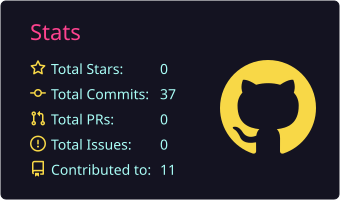
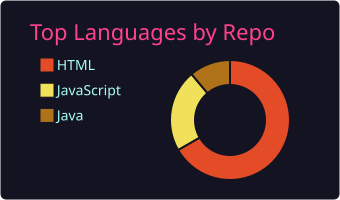
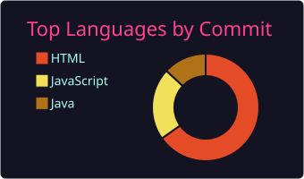

<h1 align="center">Hi 👋, I'm Pranshu Tiwari</h1>

<h3 align="center">☕ Java Developer</h3>

- 🚀 I built and launched **[Turulobe](https://turulobe.vercel.app/)**, a full-stack dating web app, now live.
- 📚 I'm currently learning **Spring Boot, MERN, PostgreSQL**.
- 🤝 I'm looking to collaborate on **Java projects, JavaScript projects and Problem Solving**.
- 🗂️ All of my projects are available at https://github.com/PranshuTiwari28.
- 🧠 Ask me about **Java, DSA, JavaScript**.
- 📧 How to reach me: **pranshu1083@gmail.com**.
- 😄 Fun fact: **I am always happy**.
- 💻 I love Problem Solving.

### Connect with me:

### Languages and Tools:

### 🚀 Projects

| Project | Description | Tech | Status |
|---|---|---|---|
| [Advanced ATM System](https://github.com/PranshuTiwari28/-Advanced-ATM-System-) | Simulation of real-world ATM operations with secure transactions, user authentication and account management | Java | ✅ Completed |
| [Guess Number Game](https://github.com/PranshuTiwari28/GuessNumberGame) · [🌐 Live](https://pranshu-tiwari-guess-number.netlify.app/) | A simple game where users try to guess a randomly generated number | HTML, CSS, JavaScript | ✅ Completed |
| [Turulobe](https://github.com/PranshuTiwari28/turulobe-backend) · [🌐 Live](https://turulobe.vercel.app/) | A full-stack dating platform where people discover matches by interests and personality, chat in real time, and connect through anonymous confessions. Includes profile search, friend connections, an in-app help chatbot, OTP email verification, dark mode, and auto-cleanup of old messages. | Java, Spring Boot, MySQL, HTML, CSS, JavaScript | ✅ Completed |

### 💘 Turulobe: Find Your Perfect Match

> *One honest conversation at a time.*

Turulobe pairs people who fit each other's pace, humor and plans, not just their photos.

**How it works:** 🔍 **Discover** people who match your interests → 💬 **Chat** and get to know each other → ❤️ **Date** and take it beyond the screen.

**Highlights**
- 🔎 Search across all members and open profiles straight from chat
- 🤝 Friend connections with the option to disconnect
- 🕵️ Anonymous confessions with "Load More" pagination
- 🤖 Built-in help chatbot on the home page
- 🔐 OTP email verification
- 🌙 Dark mode and a first-visit splash screen
- 🧹 Messages hide after 24 hours and are deleted permanently after 7 days by a nightly job

**Stack:** Java · Spring Boot · MySQL · HTML/CSS/JS · Render · Vercel

🌐 **[Try it live →](https://turulobe.vercel.app/)**

### 📊 GitHub Stats:

  
  
  

